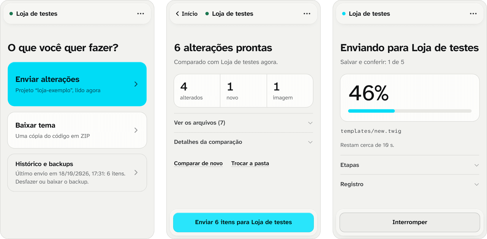

<div align="center">


# Zirtuno Sync Yampi

Edite o tema da sua loja Yampi no computador e envie as alterações de volta,<br>com comparação, backup e conferência de cada arquivo.

[](https://github.com/ZIRTUNO/zirtuno-sync-yampi/releases/latest) [](docs/INSTALACAO.md)

**[Baixar](https://github.com/ZIRTUNO/zirtuno-sync-yampi/releases/latest/download/zirtuno-sync-yampi.zip)** · [Instalação](docs/INSTALACAO.md) · [Como o envio funciona](docs/SPEC.md)

</div>

<br>

<picture>
  <source media="(prefers-color-scheme: dark)" srcset="docs/images/painel-escuro.png">
  
</picture>

## Como funciona

A extensão abre um painel ao lado do editor de código da Yampi. Por ele você baixa o tema, edita no VS Code com uma prévia local da loja e, quando terminar, envia as alterações.

Antes de gravar qualquer coisa, a extensão compara três versões de cada arquivo: a que você baixou, a do seu projeto e a que está na loja agora. Só vai para a loja o que mudou no projeto. Se alguém alterou o mesmo arquivo na loja depois do download, o envio espera a sua decisão, com a diferença linha a linha. Arquivos novos são criados e imagens novas são enviadas pelos próprios controles do editor, e cada item é conferido na Yampi depois de recarregar a página.

As alterações vão para o rascunho da loja. Os clientes só as veem quando você clica em **Publicar** na Yampi.

## Instalação

1. Baixe [zirtuno-sync-yampi.zip](https://github.com/ZIRTUNO/zirtuno-sync-yampi/releases/latest/download/zirtuno-sync-yampi.zip) e extraia numa pasta fixa.
2. Em `chrome://extensions`, ative o **Modo do desenvolvedor** e clique em **Carregar sem compactação**.
3. Selecione a pasta extraída e fixe o ícone da extensão.

Para atualizar, extraia a nova versão sobre a mesma pasta e clique em **Recarregar** no cartão da extensão. [Instruções completas](docs/INSTALACAO.md).

## Uso

Abra o [editor de código](https://app.yampi.com.br/store/code-editor/) da loja e clique no ícone da extensão.

### Baixar o tema

Escolha **Baixar tema**. Com **Incluir a vitrine publicada** ligado, o ZIP também traz o que a prévia local precisa para ficar parecida com a loja. A cópia só lê: nada muda na Yampi.

### Editar

Extraia o ZIP numa pasta, abra no VS Code e, com Node.js 24, rode:

```powershell
npm ci
npm run dev
```

A prévia abre em `http://127.0.0.1:5182`. Edite os arquivos de `tema/` e não mexa em `.yampi-sync/`, que guarda a cópia original usada na comparação. [Mais sobre o projeto e a prévia](docs/PREVIA.md).

### Enviar

Escolha **Enviar alterações** e selecione a pasta do projeto, ou arraste-a para o painel. Da segunda vez, a pasta já fica lembrada. Confira o resumo e confirme. O backup é baixado antes da primeira gravação, e o envio continua mesmo se você fechar o painel ou trocar de aba. No fim, abra a prévia da Yampi, confira e publique.

### Desfazer

**Histórico e backups** guarda cada envio. **Restaurar este envio** devolve os arquivos ao estado anterior, sem excluir nada e sem desfazer o que foi alterado depois.

## Segurança

- A loja de destino é conferida a cada etapa. Um projeto de outra loja é recusado.
- Um arquivo que mudou na loja depois do download só é substituído se você escolher. A versão da loja fica no backup.
- Cada alteração é conferida na Yampi depois de recarregar a página: os textos um a um, antes do próximo, e os arquivos criados e as imagens em grupo.
- No primeiro erro, o envio para e guarda o registro. Depois, ele continua de onde parou, sem refazer o que já foi conferido.
- A extensão nunca publica, exclui ou renomeia arquivos.

As regras completas, caso a caso, estão em [docs/SPEC.md](docs/SPEC.md).

## Limitações

A Yampi não permite criar pastas nem substituir imagens. Um arquivo novo precisa ficar numa pasta que já existe na loja, e uma imagem alterada precisa de um nome novo. As imagens ficam todas em `assets/images`: as que estão em subpastas no projeto vão para lá no envio, com as referências ajustadas.

O editor da Yampi não oferece gravação atômica. Durante um envio, não edite a loja em outra aba nem troque de loja ou de tema.

A prévia local é uma aproximação: reproduz as páginas capturadas da vitrine, mas não o checkout nem o catálogo completo. O catálogo e as configurações da loja não são exportados.

## Estado

Versão 0.6.0, validada manualmente e por testes automatizados. Os testes rodam a extensão no Chromium com um editor que reproduz a marcação do editor da Yampi, inclusive fechando o painel no meio de um envio. O histórico de validação de cada versão está em [docs/VALIDACAO.md](docs/VALIDACAO.md).

## Privacidade

A extensão não coleta dados. Ela só se comunica com o editor da Yampi aberto na aba em que você clicou e, ao baixar com a vitrine, com os endereços públicos da loja que você autorizar, um por um. A cópia original, o histórico e os backups ficam no próprio navegador.

| Permissão | Uso |
|---|---|
| `activeTab`, `scripting` | Ler e operar o editor na aba em que você clicou no ícone |
| `sidePanel` | Mostrar o painel ao lado do editor |
| `storage` | Guardar o estado das operações em andamento |
| `downloads` | Baixar o tema, os backups e os registros |
| `offscreen` | Continuar as operações com o painel fechado |
| `notifications` | Avisar quando uma operação termina com o painel fechado |
| `https://*/*` (opcional) | Ler a vitrine publicada e os recursos dela, com autorização por endereço |

A pasta do projeto é lida quando você a escolhe. A extensão só escreve nela quando você usa **Usar no projeto** para trazer uma alteração feita na loja, depois da permissão do Chrome.

## Desenvolvimento

Requer Node.js 24.

```powershell
npm ci
npm run check
npm run test:e2e
npm run package
```

`npm run check` roda a verificação de tipos, os testes e o build. `npm run test:e2e` instala a extensão num Chromium temporário e percorre exportação, envio e restauração com o editor fictício; nenhuma requisição chega à Yampi. `npm run package` gera a pasta pronta para carregar em `releases/zirtuno-sync-yampi/` e o ZIP de distribuição em `.cache/package/`. Para ver o painel sem uma loja, `npm run dev` abre uma demonstração em `http://127.0.0.1:5181/demo.html?demo=1`.

A documentação técnica está em [docs](docs): [contrato do envio](docs/SPEC.md), [interface](docs/INTERFACE.md), [validação](docs/VALIDACAO.md), [decisões](docs/JOURNAL.md), [próximas etapas](docs/ROADMAP.md) e [licenças de terceiros](docs/TERCEIROS.md).

<br>

<p align="center"><sub>Desenvolvido por <a href="https://www.instagram.com/zirtuno/">Zirtuno</a></sub></p>
